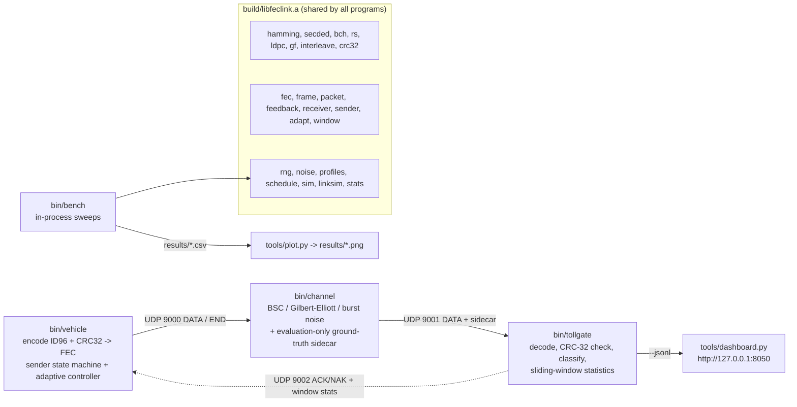

# Adaptive Multi-Error FEC Link Layer for High-Interference Environments

[](https://github.com/PavitranVC/Adaptive-FEC-Link/actions/workflows/ci.yml)

A vehicle's 96-bit RFID tag ID, protected by a CRC-32, travels to a roadside toll unit over a
noisy wireless link. Instead of asking for a retransmission (slow - the car is moving), the
receiver **corrects errors in place** with forward error correction (FEC). This repository
simulates that link in software as three UDP processes (vehicle, noisy channel, tollgate) and
compares seven error-correcting codes - Hamming, SECDED, BCH, Reed-Solomon and LDPC, with an
optional bit interleaver - against Stop-and-Wait ARQ, Hybrid ARQ and an adaptive code-ladder
controller, under a random-error "toll plaza" profile and a bursty "hospital imaging" profile.
Every code, the CRC, the RNG and the Galois-field arithmetic are implemented from scratch in C11;
results are reproducible from a seed and reported with 20-seed confidence intervals.
University Computer Networks project, extending the approved project "Fast-Lane FEC for
Automated Toll Booths".

## Features

| area | what is implemented |
|---|---|
| codes | Hamming(7,4), Hamming(15,11), SECDED(8,4), BCH(15,7) t=2, BCH(31,16) t=3, shortened Reed-Solomon RS(16+2t,16) over GF(256) (t = 1..16, default 4), (3,6)-regular LDPC(256,128) with Gallager bit flipping, uncoded baseline |
| error detection | CRC-32 (IEEE 802.3) over the 12 ID bytes; frames classified CORRECT / DETECTED_FAIL / SILENT_WRONG |
| burst handling | generic bit-level block interleaver (`--interleave D`) for any code |
| channel models | binary symmetric channel, Gilbert-Elliott (state kept across frames), burst of length L; two profiles; toll -> hospital -> toll schedules |
| link strategies | plain FEC, Stop-and-Wait ARQ, Hybrid ARQ type I, adaptive code ladder (mixed or all-RS) with hysteresis and probe back-off |
| feedback | ACK/NAK + sliding-window statistics on UDP 9002, loss injection (`--fb-drop`) |
| evaluation | in-process benchmark (`bin/bench`) on the same library, goodput, p99 latency on a simulated clock, Student-t 95% CIs and paired differences over 20 seeds, matplotlib plots |
| observability | coloured per-frame bit map, JSON-lines log, live stdlib-only web dashboard |
| robustness | failure injection (malformed / truncated / duplicate packets, header corruption, port in use, lost END), seeded fuzz test, ASan + UBSan build, GitHub Actions CI on Ubuntu and macOS |

## Architecture



Text fallback:

```
 bin/vehicle --UDP 9000--> bin/channel --UDP 9001--> bin/tollgate --jsonl--> tools/dashboard.py
  (encoder, ARQ/HARQ,       (noise injector,           (decoder, CRC check,
   adaptive controller)      ground-truth sidecar)      classification, window stats)
       ^                                                      |
       +------------- UDP 9002 ACK/NAK + window statistics ---+

 build/libfeclink.a  <- every program links the same library
 bin/bench (no sockets, simulated clock) --> results/*.csv --> tools/plot.py --> results/*.png
```

Each received frame is classified as **CORRECT**, **DETECTED_FAIL** (CRC failed - the system knows
it must not bill this read) or **SILENT_WRONG** (CRC passed but the ID is wrong - the dangerous
case, measurable only because the channel attaches ground truth that the decoder never reads).

## Quick start

```sh
git clone https://github.com/PavitranVC/Adaptive-FEC-Link.git && cd Adaptive-FEC-Link
make                 # build bin/vehicle bin/channel bin/tollgate bin/bench
make test            # unit, integration, failure-injection and dashboard tests
make demo            # one-terminal live demo (toll plaza profile)
make demo-adaptive   # adaptive FEC on a toll -> hospital -> toll channel
```

Setup per OS (WSL / Ubuntu / macOS), every demo, the dashboard, plots, troubleshooting and the
presentation script: **[docs/DEMO.md](docs/DEMO.md)**.

## Results summary

Numbers copied from [docs/REPORT.md](docs/REPORT.md), which sources them from `results/*.csv`
(`make bench`). Noise parameters, RTT and bit rate are modelling assumptions.

**Codes** (frame success rate, single seed 42, 5000 frames per point; GE = Gilbert-Elliott, p_gb = 0.005):

| code | rate | toll BSC p=0.01 | toll GE | hospital GE | burst L=16 |
|---|---|---|---|---|---|
| uncoded | 1.0000 | 0.2700 | 0.3328 | 0.3952 | 0.0000 |
| Hamming(7,4) | 0.5714 | 0.9354 | 0.7752 | 0.4170 | 0.0014 |
| Hamming(7,4) + il8 | 0.5714 | 0.9360 | 0.9394 | 0.6106 | 0.0956 |
| BCH(31,16) | 0.5161 | 0.9986 | 0.9596 | 0.4936 | 0.0126 |
| BCH(31,16) + il8 | 0.5161 | 0.9980 | 0.9978 | 0.8374 | 1.0000 |
| RS t=4 | 0.6667 | 0.9634 | 0.9756 | 0.8336 | 1.0000 |
| RS t=8 | 0.5000 | 0.9996 | 0.9996 | 0.9532 | 1.0000 |
| LDPC(256,128) | 0.5000 | 0.9994 | 0.9988 | 0.7902 | 0.9690 |

**Strategies** on the toll -> hospital -> toll channel (20 seeds, mean +- 95% CI, RTT 20 ms):

| strategy | success | goodput | retx / frame | p99 latency (ms) |
|---|---|---|---|---|
| FEC RS t=8 | 0.9817 +- 0.0010 | 0.4909 +- 0.0005 | 0 | 11.6 |
| Stop-and-Wait ARQ (uncoded) | 0.8244 +- 0.0028 | 0.2960 +- 0.0019 | 1.785 +- 0.009 | 94.0 |
| HARQ BCH(31,16) | 0.9932 +- 0.0006 | 0.4285 +- 0.0009 | 0.196 +- 0.002 | 76.2 |
| HARQ RS t=8 | 1.0000 | 0.4910 +- 0.0005 | 0.018 +- 0.001 | 33.2 |
| **HARQ RS t=4** | 0.99998 +- 0.00003 | **0.6126 +- 0.0012** | 0.088 +- 0.002 | 42.0 +- 5.1 (bimodal) |
| Adaptive (mixed ladder) | 0.9995 +- 0.0001 | 0.5043 +- 0.0025 | 0.069 +- 0.002 | 33.2 |
| Adaptive (all-RS ladder, pre-registered experiment) | 0.99999 +- 0.00002 | 0.5841 +- 0.0040 | 0.0554 +- 0.0025 | 33.0 +- 0.1 |

Findings:

* Random errors (toll): BCH(31,16) is the best of the original codes; Hamming(7,4) is a cheap fallback.
* Bursts (hospital): bit-level codes collapse; Reed-Solomon (byte symbols) or an interleaver
  restores them. LDPC with hard-decision bit flipping is best on random errors at rate 1/2 but
  worse than Reed-Solomon on bursts.
* **SILENT_WRONG = 0 in 1,395,000 frames per profile**: CRC-32 caught every miscorrection.
* The adaptive controller does **not** beat fixed HARQ + RS t=4 on goodput (paired difference
  -0.1083 +- 0.0030); it wins on retransmissions per frame and p99 latency. Its goodput advantage
  over always-RS t=8 is real but small (+0.0133 +- 0.0024). The all-RS ladder met its
  pre-registered criterion but is still below HARQ + RS t=4 (-0.0284 +- 0.0038).


## Documentation

| document | contents |
|---|---|
| [docs/DEMO.md](docs/DEMO.md) | setup per OS, every demo, dashboard, troubleshooting, 2-minute talking script |
| [docs/REPORT.md](docs/REPORT.md) | project report: problem, architecture, experiments E1-E7, results, limitations |
| [docs/ALGORITHMS.md](docs/ALGORITHMS.md) | formulas with worked examples produced by running the code (CRC, Hamming, GF, BCH, RS, interleaver, LDPC, noise, metrics, statistics, controller) |
| [docs/DESIGN_DECISIONS.md](docs/DESIGN_DECISIONS.md) | design records DD-01..DD-29: decision, alternative, rationale, evidence |
| [docs/ARCHITECTURE_HISTORY.md](docs/ARCHITECTURE_HISTORY.md) | how the architecture changed per version v0.1-v0.4, why, what failed; branch and tag map |
| [docs/STATUS.md](docs/STATUS.md) | current state, test status, honest findings, known issues, open problems |
| [docs/ROADMAP.md](docs/ROADMAP.md) | phases and versions with their checklists, future work |
| [docs/DEVELOPMENT.md](docs/DEVELOPMENT.md) | environment, build and test matrix, adding a code, branch naming, release process |
| [CONTRIBUTING.md](CONTRIBUTING.md) | specification, fixed interface contract, folder layout, coding rules |

## Repository layout

```
.
├── include/            public headers, one per library module
├── src/                library modules -> build/libfeclink.a
│   └── apps/           vehicle.c, channel.c, tollgate.c -> bin/
├── tests/              unit tests (test_<module>.c), integration and failure-injection scripts,
│                       dashboard test, inject.c (sends malformed packets)
├── tools/              bench.c (-> bin/bench), plot.py, demo.sh, compare.sh, dashboard.py/.sh,
│                       header_experiment.sh, check_docs.sh
├── results/            final plots (*.png, tracked); CSVs are regenerated and git-ignored
├── docs/               documentation (table above)
├── .github/workflows/  ci.yml - build + test on Ubuntu and macOS, sanitizers on Ubuntu
├── Makefile            build, test, sanitize, demos, bench, plots
├── CONTRIBUTING.md
└── requirements.txt    matplotlib (plots only)
```

## Limitations

* Software simulation only: no hardware, no over-the-air measurement; decode times are of the
  simulation host.
* Noise parameters of both profiles, the 20 ms RTT, the 100 ms timeout and the 160 kbit/s bit
  rate are modelling assumptions; conclusions hold for this simulated channel.
* The frame header is never corrupted by default (DD-01). When it is (`--corrupt-header`), a
  flipped sequence number can misroute a frame and the tollgate over-reports CORRECT; the fix
  (a header CRC-16) is an open problem.
* HARQ is type I (no soft combining); the LDPC decoder is hard-decision bit flipping only.
* The adaptive controller did not beat the best fixed strategy on goodput (see above).
* `make test` and `make sanitize` were run on Ubuntu with gcc 13 (and `make test` with clang);
  macOS is covered by CI; WSL by one manual run of the demo guide.

## Reproducing the results

```sh
make test                                       # all tests
make sanitize                                   # all tests under ASan + UBSan
make bench                                      # regenerates every results/*.csv (1-2 minutes)
pip install -r requirements.txt && make plots   # results/*.png (needs matplotlib)
sh tools/header_experiment.sh 2000              # header corruption -> results/header_corruption.csv
make compare                                    # hamming74 vs bch157 on the same seed
```

All runs are seeded (`SEED=42`; multi-seed runs use seeds 42..61), so the same command gives the
same success rates and retransmission counts; latency columns vary by microseconds (real decode time).

## Project history

How the design evolved from the first commit to this version, what was measured at each step and
what went wrong: **[docs/ARCHITECTURE_HISTORY.md](docs/ARCHITECTURE_HISTORY.md)**.
