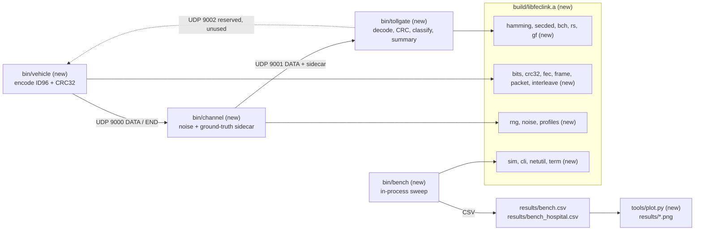
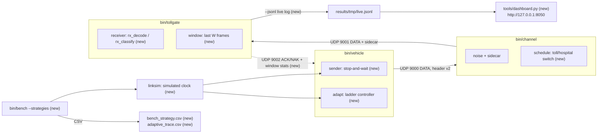
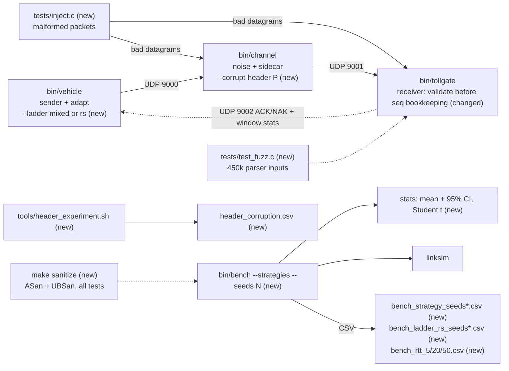

# Architecture history

How the architecture of *Adaptive Multi-Error FEC Link Layer for High-Interference Environments*
changed from the first commit to the final `main`, why each change was made, and what failed.

**Sources.** Everything below comes from `git log` / `git show` / `git ls-tree` on `main` and the
remote branches, from `DECISIONS.md`, `PROGRESS.md`, `PLAN.md`, `README.md`, `docs/REPORT.md`,
`docs/DEMO.md`, and from the `results/*.csv` files regenerated with `make bench` on `main`
(`53c6109`) while writing this document (the CSVs are git-ignored, so they had to be regenerated).
A few checks were re-run by hand for this document; they are marked **(re-run for this document)**.
A number that could not be sourced is written "not measured".

**Version boundaries (confirmed from git).** The history is one linear chain of 37 commits on
`main`; every feature branch was fast-forwarded into it. Branch heads: `claude/bold-gauss-xza289`
= `aa2aaac`, `week2` = `fc5dc28` (= tag `v0.2-week2`), `final-polish` = `c4d7bf4`, `overnight-a`
= `bde2409`, `gate-a` = `754e3e9`, `overnight-b` = `ecd770f`, `gate-b` = `9933409`, `overnight-c`
= `539acca`, `docs-fix` = `b9f8436`, `docs-timings` = `53c6109` = `main`.

| version | git range (oldest..newest) | commits | dates | branches |
|---|---|---|---|---|
| v0.1 | `18c8a87`..`aa2aaac` | 9 | 2026-10-08 | `claude/bold-gauss-xza289` |
| v0.2 | `04a7423`..`fc5dc28` | 6 | 2026-10-08 | `week2`, tag `v0.2-week2` |
| v0.3 | `a6c204e`..`754e3e9` | 12 | 2026-10-08 .. 2026-10-16 | `final-polish`, `overnight-a`, `gate-a` |
| v0.4 | `a5bc434`..`53c6109` | 10 | 2026-10-16 | `overnight-b`, `gate-b`, `overnight-c`, `docs-fix`, `docs-timings` |

Adjustment to the brief: `gate-a` (`754e3e9`) is counted in **v0.3**, because it only corrects
numbers of the overnight-A results; `gate-b` (`9933409`) is counted in v0.4 because it checks
`docs/REPORT.md`, which is a v0.4 file.

Contents: [v0.1](#v01---week-1-phases-0-6) · [v0.2](#v02---week-2-feedback-arq-harq-adaptive-dashboard) ·
[v0.3](#v03---final-polish--overnight-a-fair-baselines-statistics-failure-injection) ·
[v0.4](#v04---overnight-bc-and-docs-ci-report-ldpc-demo-fixes) ·
[A. At a glance](#a-architecture-evolution-at-a-glance) · [B. Results timeline](#b-results-timeline) ·
[C. Lessons](#c-lessons-learned) · [D. Doc issues](#d-doc-issues) · [E. Reproduce](#e-how-to-reproduce-each-version)

---

## v0.1 - Week 1, phases 0-6

### 1. Summary

One-way FEC link: `bin/vehicle` encodes the 96-bit tag ID + CRC-32 with one of six codes (plus an
uncoded baseline), `bin/channel` flips bits (BSC, Gilbert-Elliott or burst model, two profiles)
and appends a ground-truth sidecar, `bin/tollgate` decodes and classifies. All coding logic lives
in one library (`build/libfeclink.a`) shared with an in-process benchmark (`bin/bench`).
Git range `18c8a87`..`aa2aaac` (phase0 `18c8a87`, phase1 `7ab039a`, phase2 `612e846`,
phase3 `c9bc2c7`, phase4 `bbbd2ed`, phase5 `175f75e`, phase6 `d8f026a`, docs `c9cd2a3`, `aa2aaac`).

### 2. Architecture diagram

Everything is new in v0.1. Port 9002 exists only as a reserved flag (`--feedback-port`); nothing
is sent on it yet.



ASCII fallback:

```
 bin/vehicle (new) --UDP 9000--> bin/channel (new) --UDP 9001--> bin/tollgate (new)
  encode ID96+CRC32               noise (bsc/ge/burst)            decode, CRC-32 check,
  FEC code + interleaver          + ground-truth sidecar          classify, summary
        ^                                                                |
        +------------------ UDP 9002 (reserved, unused) ----------------+

 build/libfeclink.a (new): bits crc32 hamming secded gf bch rs interleave fec frame packet
                           rng noise profiles sim cli netutil term version
 bin/bench (new) --> sim (same library, no sockets) --> results/bench.csv, bench_hospital.csv
                                                    --> tools/plot.py --> results/*.png (10 PNGs)
```

### 3. What changed

| component | change | files / modules | commit |
|---|---|---|---|
| scaffolding | Makefile, docs, home-made test helper | `Makefile`, `tests/testlib.h`, `CLAUDE.md`, `PLAN.md`, `DECISIONS.md` | `18c8a87` |
| coding core | bits one-per-byte, CRC-32 (bitwise IEEE 802.3), Hamming(7,4)/(15,11), SECDED(8,4) | `src/bits.c`, `crc32.c`, `hamming.c`, `secded.c` | `7ab039a` |
| channel model | xoshiro256** RNG, BSC / Gilbert-Elliott / burst, TOLL_PLAZA and HOSPITAL_IMAGING | `src/rng.c`, `noise.c`, `profiles.c` | `612e846` |
| processes | three UDP programs, wire format v1 (14-byte header), sidecar, CLI, demo/compare scripts | `src/apps/*.c`, `src/packet.c`, `frame.c`, `fec.c`, `cli.c`, `netutil.c`, `tools/demo.sh`, `compare.sh`, `docs/DEMO.md` | `c9bc2c7` |
| codes | GF(2^m), BCH(15,7) t=2, BCH(31,16) t=3 (Berlekamp-Massey + Chien) | `src/gf.c`, `bch.c` | `bbbd2ed` |
| evaluation | in-process benchmark, CSV, matplotlib plots | `src/sim.c`, `tools/bench.c`, `tools/plot.py` | `175f75e` |
| codes | shortened RS(16+2t,16) over GF(256), generic bit block interleaver | `src/rs.c`, `interleave.c` | `d8f026a` |
| docs | results table in README, final PROGRESS | `README.md`, `PROGRESS.md` | `c9cd2a3`, `aa2aaac` |

### 4. Why

| change | problem it solved / question it answered | evidence |
|---|---|---|
| library + three thin programs | benchmark and UDP pipeline must run exactly the same code | DECISIONS.md "Phase 0" |
| CRC-32 on top of every code | a miscorrection must never bill the wrong car | SILENT_WRONG 0 of 1,395,000 frames in `bench.csv` and 0 of 1,395,000 in `bench_hospital.csv` |
| ground-truth sidecar (decision #6) | live CORRECT / DETECTED_FAIL / SILENT_WRONG classification in the demo | DECISIONS.md "Phase 3" |
| Gilbert-Elliott state kept across frames (#2) | real interference does not know frame boundaries | DECISIONS.md "Phase 2" |
| BCH(31,16) | stronger random-error correction than Hamming | toll BSC p=0.01: 0.9986 vs Hamming(7,4) 0.9354 (`bench.csv`) |
| Reed-Solomon (byte symbols) | bit-level codes collapse on hospital bursts | hospital GE p_gb=0.005: RS t=4 0.8336 vs BCH(31,16) 0.4936, Hamming(7,4) 0.4170 (`bench_hospital.csv`) |
| bit interleaver (#11) | rescue Hamming/BCH against bursts | burst L=16: BCH(31,16) 0.0126 -> BCH(31,16)+il8 1.0000 (`bench.csv`) |
| in-process benchmark | 155,000 frames per code and profile are too slow over UDP | 279 rows x 5000 frames in `bench.csv` |

### 5. Wire format / interface changes

| item | v0.1 |
|---|---|
| DATA/END header | 14 bytes, `PACKET_VERSION 1`: magic "FL", ver, type, code, rs_t, interleave, flags, seq (4), nbits (2) |
| payload | `FEC(ID96 || CRC32)`, bits packed MSB-first, the only corrupted part |
| sidecar | flips (2), profile, model, true tag (12), clean coded bits |
| CLI flags | `--code --profile --model --p --seed --count --delay-ms --burst-len --rs-t --interleave --channel-port --tollgate-port --feedback-port --host --idle-timeout-ms --log --summary-file --show-bits --quiet --color/--no-color --frames --out --help` |
| codes (`--code`) | `none hamming74 hamming1511 secded84 bch157 bch3116 rs` (7 incl. uncoded) |
| make targets | `all test unit-test integration-test demo demo-hospital compare bench plots clean` |

### 6. Test and verification

| test | what it checks | result |
|---|---|---|
| 15 unit-test binaries, 91 test cases (`tests/test_*.c` at `aa2aaac`) | exhaustive single-error Hamming, SECDED double-error detection, BCH weight <= t exhaustive + 200k randomized, RS burst correction, noise statistics | pass |
| `tests/test_integration.sh` | real three-process UDP runs, reproducibility, hospital, BCH, RS, interleaver, compare, bench + plot smoke tests | pass |
| fresh checkout of `aa2aaac`: `make` + `make test` | **(re-run for this document)** | `make` exit 0, `make test` exit 0, "Integration test passed." (plot smoke test skipped: no matplotlib) |

### 7. What failed / what we got wrong

1. **Bit-level codes barely beat "uncoded" on the hospital channel.**
   Expected: any FEC code clearly helps. Actual (hospital GE p_gb=0.005, `bench_hospital.csv`):
   uncoded 0.3952, Hamming(7,4) 0.4170, BCH(15,7) 0.3912, SECDED(8,4) 0.3654 - two codes are
   *worse* than no code. Root cause: Hamming/BCH correct 1-3 bits per block; a 12.5-bit mean burst
   puts many errors in one block. Handled: RS and the interleaver were added in phase 6 (`d8f026a`),
   RS t=4 reaches 0.8336.
2. **The bigger Hamming and SECDED were worse than Hamming(7,4).** Toll BSC p=0.01 (`bench.csv`):
   Hamming(15,11) 0.8956 and SECDED(8,4) 0.9174 vs Hamming(7,4) 0.9354. Root cause: a longer block
   collects more errors per block; SECDED only *detects* the second error, so frame success does
   not improve. Reported as a result, nothing changed.
3. **Bursts longer than the code's design still break everything.** Burst L=16 in every frame:
   Hamming(7,4) 0.0014, BCH(31,16) 0.0126 (`bench.csv`). Expected (it is the point of the burst
   sweep); handled by RS / interleaving. The interleaver's "one burst error per block" guarantee
   only holds when the depth divides the coded length (DECISIONS.md "Phase 6") - left as documented.

### 8. Decisions still open / limitations

- The header is never corrupted (decision #1) - tested only later (v0.3).
- Noise parameters of both profiles are modelling assumptions (decision #5), not measurements.
- No feedback path: a DETECTED_FAIL frame is simply lost (no retransmission).
- RS uses one shortened codeword per frame (decision #10); a symbol interleaver for RS was not built.
- Decode latency is measured on the simulation host only.

---

## v0.2 - Week 2: feedback, ARQ, HARQ, adaptive, dashboard

### 1. Summary

The link became two-way. The tollgate answers every frame with ACK/NAK plus sliding-window
statistics on UDP 9002; the vehicle runs a stop-and-wait state machine (ARQ, Hybrid ARQ) and an
adaptive controller that climbs a six-rung code ladder. The decoder was moved into its own module
so it structurally cannot read the ground truth. A link simulator runs the same protocol in-process
on a simulated clock, and a stdlib-only Python dashboard shows a run live.
Git range `04a7423`..`fc5dc28` (task1 `04a7423`, task2 `5c3040a`, task3 `04e8807`, task4 `abcfd0b`,
docs `fad9808`, `fc5dc28`); tag `v0.2-week2` -> `fc5dc28`.

### 2. Architecture diagram



ASCII fallback:

```
            +------------------------- UDP 9002 ACK/NAK + window stats (new) ---------------+
            v                                                                               |
 bin/vehicle --UDP 9000 (header v2)--> bin/channel --UDP 9001--> bin/tollgate               |
  sender.c   stop-and-wait (new)        noise + sidecar           receiver.c (new): decode  |
  adapt.c    ladder controller (new)    schedule.c (new):         never sees the sidecar    |
                                         toll -> hospital -> toll window.c (new): last W ---+
                                                                  --jsonl FILE (new)
                                                                        |
                                              tools/dashboard.py (new) <+  http://127.0.0.1:8050

 bin/bench --strategies (new) --> linksim.c (new, same sender + adapt + receiver, simulated clock)
                              --> results/bench_strategy.csv, adaptive_trace.csv (new)
 feedback.c (new): 22-byte ACK/NAK format
```

### 3. What changed

| component | change | files / modules | commit |
|---|---|---|---|
| tollgate receive path | decode moved into a module with no parameter for the truth; `rx_classify` is the only sidecar reader | `src/receiver.c`, `include/receiver.h`, `tests/test_receiver.c` | `04a7423` |
| feedback channel | ACK/NAK on 9002 (22 bytes), `--fb-drop` loss injection | `src/feedback.c` | `5c3040a` |
| strategies | `--strategy fec/arq/harq/adaptive`; one stop-and-wait state machine for vehicle and simulator | `src/sender.c`, `src/apps/vehicle.c`, `tollgate.c` | `5c3040a` |
| wire format | header v2 (+`attempt`, +`strategy`) | `src/packet.c`, `include/packet.h` | `5c3040a` |
| simulator | in-process link with simulated RTT, airtime at 160 kbit/s | `src/linksim.c` | `5c3040a` |
| controller (first version) | ladder + sliding window, evaluated on **every** feedback, up threshold 0.15 (committed inside the ARQ commit) | `src/adapt.c`, `src/window.c` | `5c3040a` |
| controller (redesign) | one decision per W=32 fresh frames, up 0.20, probe back-off | `src/adapt.c`, `include/adapt.h`, `tests/test_adapt.c`, `tests/test_linksim.c` | `04e8807` |
| channel | `--schedule toll:N,hospital:M,...` (counts transmissions) | `src/schedule.c`, `src/apps/channel.c` | `04e8807` |
| observability | tollgate `--jsonl`, Python stdlib dashboard, `make dashboard` | `tools/dashboard.py`, `tools/dashboard.sh`, `src/apps/tollgate.c` | `abcfd0b` |
| docs | PROGRESS, README results, PLAN checkboxes, test count fix | `PROGRESS.md`, `README.md`, `PLAN.md`, `tests/test_cli.c` | `fad9808`, `fc5dc28` |

### 4. Why

| change | problem it solved / question it answered | evidence |
|---|---|---|
| `src/receiver.c` | "could the decoder cheat with the sidecar?" (decision #6) | `tests/test_receiver.c`: 2100 corrupted frames, all 7 codes, sidecar present / zeroed / garbage / stripped -> bit-identical output (DECISIONS.md "Phase 3") |
| ARQ baseline | the "retransmission" strawman the project argues against | schedule channel, seed 42: ARQ 0.8194 success, 1.7828 retx/frame, p99 94.009 ms (`bench_strategy.csv`) |
| Hybrid ARQ (type I, #17) | FEC alone leaves failed frames lost | best plain FEC (RS t=4) 0.9136 vs HARQ RS t=4 1.0000 on the schedule channel (`bench_strategy.csv`) |
| vehicle decides, tollgate reports (#13) | the sender owns the code; the receiver stays stateless | DECISIONS.md "Week 2 - task 3" |
| step down only on a binomial prediction (#14) | corrected-bit counts are not comparable across codes | DECISIONS.md "Week 2 - task 3"; test `predicted_failure_matches_binomial_maths` |
| one decision per window (#15) | first controller flapped | 14 level changes in 3000 steady toll frames -> 0 (DECISIONS.md); test `adaptive_does_not_oscillate_on_a_steady_channel` |
| `--schedule` | a controller can only be shown on a channel that changes | adaptive 0.9994 success, 8 level changes, p99 33.211 ms (`bench_strategy.csv`, schedule) |
| shared `sender.c` + `linksim.c` | benchmark must measure the same protocol as the UDP demo | DECISIONS.md "Week 2 - task 2" |
| dashboard, stdlib only (#19) | nothing to install on the presentation laptop | DECISIONS.md "Week 2 - task 4" |

### 5. Wire format / interface changes

| item | v0.1 | v0.2 |
|---|---|---|
| DATA/END header | 14 bytes, version 1 | **16 bytes, version 2**: + `attempt` (offset 14), + `strategy` (offset 15) |
| feedback packet | none | **new**, 22 bytes: magic "FB", ver, type ACK/NAK, seq, attempt, level, win_n, win_fail, win_corrected, win_bits |
| port 9002 | reserved | **used**: tollgate -> vehicle, never corrupted, can be lost (`--fb-drop`) |
| new CLI flags | - | `--strategy --rtt-ms --timeout-ms --max-retries --fb-drop --window --up-threshold --down-threshold --start-level --schedule --strategies --trace --jsonl` |
| new make targets | - | `demo-arq demo-harq demo-adaptive dashboard` |
| new bench outputs | - | `results/bench_strategy.csv`, `results/adaptive_trace.csv`; PNGs 10 -> 12 (`strategy_comparison.png`, `adaptive_level.png`) |

### 6. Test and verification

| test | what it checks | result |
|---|---|---|
| 20 unit-test binaries, 123 test cases (`tests/test_*.c` at `fc5dc28`) | new: `test_receiver`, `test_feedback`, `test_adapt`, `test_linksim`, `test_schedule` | pass in the original session (PROGRESS.md at `fc5dc28`) |
| `tests/test_integration.sh` | + ARQ, HARQ with 30% injected feedback loss, adaptive on toll->hospital->toll, JSON-lines log + dashboard HTTP server | pass in the original session |
| `tests/test_dashboard.py` | dashboard state parsing | **referenced by the Makefile but not in git** (see failure 3) |
| fresh checkout of `fc5dc28`: `make test` | **(re-run for this document)** | **fails**: exit 2, `python3: can't open file '.../tests/test_dashboard.py'` (all C tests and the integration script passed before that line) |

### 7. What failed / what we got wrong

1. **The first adaptive controller flapped.** Expected: hysteresis (up 0.15 / down 0.05) keeps
   the level stable on a steady channel. Actual: it went L1 <-> L2 **14 times in 3000 steady toll
   frames** (DECISIONS.md "Week 2 - task 3"). Root cause: the rule was evaluated on every feedback
   over a *sliding* window (`5c3040a`, `include/adapt.h`: "evaluated on every feedback"), so one
   unlucky stretch gave the up-rule ~W correlated chances to fire. Fixed in `04e8807`: one decision
   per W fresh frames on disjoint windows, up threshold 0.20, probe back-off; 0 changes, guarded by
   `adaptive_does_not_oscillate_on_a_steady_channel` (`tests/test_linksim.c`).
2. **"RS + interleaving" at the top of the ladder made RS worse.** Expected (task spec): the
   interleaver strengthens the top rung. Actual (DECISIONS.md, hospital, 5000 frames): RS t=4
   **83.4%** alone, **77.4 / 69.5 / 59.8%** with bit interleaving d = 2 / 4 / 8.
   **(re-run for this document**, UDP pipeline, hospital, seed 42, 5000 frames: 84.1 / 78.2 / 70.4 /
   60.6%; RS t=8 alone 95.8%.) Root cause: a bit interleaver spreads one burst over *more* bytes,
   the opposite of what a byte-symbol code wants. Handled: ladder top = RS t=8 without interleaving
   (decision #12); RS t=8 reaches 95.3% hospital / 99.96% toll (DECISIONS.md).
3. **`make test` failed on a fresh clone.** `abcfd0b` added `tests/test_dashboard.py` to the
   Makefile, but `.gitignore` line `tests/test_*` (exceptions only for `.c` and `.sh`) hid the file,
   so it was never committed. The original session passed because the file existed locally.
   Confirmed for this document (exit 2 at `fc5dc28`). Fixed in v0.3 by `892bd77` (file added,
   `!tests/test_*.py` exception).
4. **Wrong test count in PROGRESS.md.** `fad9808` said "21 unit-test binaries"; there were 20.
   Fixed in `fc5dc28`.
5. **The `v0.2-week2` tag push was reported as done, then as impossible.** `fc5dc28` PROGRESS.md:
   "tagged `v0.2-week2` ... All pushes succeeded". `c4d7bf4` corrected it: "exists only locally:
   the session proxy refused tag pushes with HTTP 403". Today `git ls-remote --tags origin` shows
   `v0.2-week2` -> `fc5dc28` on GitHub, so the tag was pushed at a later, unrecorded point and
   PROGRESS.md is now outdated (see D. Doc issues).
6. **HARQ does not rescue weak codes on bursts.** Hospital only, seed 42 (`bench_strategy.csv`):
   HARQ + Hamming(7,4) 0.9200 success with 1.2528 retx/frame and p99 97.011 ms, HARQ + BCH(31,16)
   0.9622 / 0.9646 / 97.778 ms, while HARQ + RS t=4 reaches 1.0000 / 0.2034 / 53.609 ms. Root cause:
   type I HARQ repeats the same weak code; each copy fails for the same reason (bursts). Reported;
   it is why the ladder ends in RS.

### 8. Decisions still open / limitations

- HARQ is type I, no soft combining (#17); no incremental redundancy.
- RTT 20 ms, timeout 100 ms and 160 kbit/s are assumptions (#18); RTT sensitivity came only in v0.3.
- BER^ ignores failed frames, so it under-estimates on bursty channels (PROGRESS.md "Known issues").
- Adaptive flags (`--window`, thresholds) must be given to vehicle **and** tollgate.
- The tollgate's duplicate filter keeps `seq mod 65536`.
- The comparison baselines did not yet include "always use the strongest code" with HARQ.

---

## v0.3 - Final polish + overnight A: fair baselines, statistics, failure injection

### 1. Summary

No new process; the architecture was *hardened and measured*. A goodput metric and the
"always strongest code" baselines (HARQ + RS t=4 / t=8) showed that the adaptive controller's main
claim did not hold. The channel gained header-corruption injection, the build gained ASan/UBSan and
a fuzz test, the benchmark gained 20-seed statistics with confidence intervals, and the controller
gained a second, pre-registered ladder (`--ladder rs`). Git range `a6c204e`..`754e3e9`
(polish `a6c204e`, `e00eef7`, `c4d7bf4`; overnight A `892bd77`, `550ca0d`, `dd89f72`, `af91465`,
`955da8c`, `ac2adbb`, `b409980`, `bde2409`; gate A `754e3e9`).

### 2. Architecture diagram



ASCII fallback:

```
 bin/vehicle --UDP 9000--> bin/channel ----------------UDP 9001--> bin/tollgate
  sender + adapt            noise + sidecar                         receiver: validate packet
  --ladder mixed|rs (new)   --corrupt-header P (new):               BEFORE seq bookkeeping (changed)
                            1-4 header bit flips, END exempt        empty datagram = malformed (changed)
      ^                                                                  |
      +-------------------- UDP 9002 ACK/NAK + window stats -------------+

 tests/inject.c (new) ----- malformed / truncated / duplicate datagrams --> channel, tollgate
 tests/test_fuzz.c (new) -- 200k packet_parse + 200k feedback_parse + 50k --schedule inputs
 make sanitize (new) ------ every unit + integration test under ASan + UBSan (build/asan)
 bin/bench --strategies --seeds 20 (new) --> stats.c (new, Student t) --> *_seeds*.csv
 bin/bench --rtt-ms 5/20/50 ----------------------------------------------> bench_rtt_*.csv
 tools/header_experiment.sh (new) ----------------------------------------> header_corruption.csv
```

### 3. What changed

| component | change | files / modules | commit |
|---|---|---|---|
| docs | DEMO.md becomes the single demo guide | `docs/DEMO.md`, `README.md` | `a6c204e` |
| evaluation | goodput metric; baselines HARQ + RS t=4 / t=8 and FEC RS t=8 | `src/linksim.c`, `tools/bench.c`, `tools/plot.py` | `e00eef7` |
| evaluation | RTT sensitivity 5 / 20 / 50 ms | `Makefile`, `tools/plot.py` | `c4d7bf4` |
| tests | restore hidden `tests/test_dashboard.py`, `.gitignore` exception | `.gitignore`, `tests/test_dashboard.py` | `892bd77` |
| channel | `--corrupt-header P` (separate RNG stream) | `src/packet.c`, `src/apps/channel.c` | `550ca0d` |
| tollgate / net | empty datagram, seq stealing and `SO_REUSEADDR` bugs fixed | `src/netutil.c`, `src/apps/tollgate.c` | `550ca0d` |
| tests | failure injection | `tests/inject.c`, `tests/test_packet.c`, `tests/test_failure.sh`, `tools/header_experiment.sh` | `550ca0d` |
| build | `make sanitize` (ASan + UBSan), seeded fuzz test | `Makefile`, `tests/test_fuzz.c` | `dd89f72` |
| RS decoder | output the received bytes on failure (was uninitialized) | `src/rs.c`, `tests/test_rs.c` | `dd89f72` |
| statistics | `--seeds N`, mean +- 95% CI (Student t), paired differences | `src/stats.c`, `tests/test_stats.c`, `tools/bench.c` | `af91465` |
| controller | pre-registration, then `--ladder {mixed,rs}`, then the result | `DECISIONS.md`; `src/adapt.c`; `tools/bench.c` | `955da8c`, `ac2adbb`, `b409980` |
| docs | PROGRESS, gate A number corrections | `PROGRESS.md`, `DECISIONS.md` | `bde2409`, `754e3e9` |

### 4. Why

| change | problem it solved / question it answered | evidence |
|---|---|---|
| goodput + HARQ RS t=4/t=8 baselines | "is adaptive better than always using the strongest code?" was never measured | single seed: adaptive 0.505, HARQ RS t=8 0.490, HARQ RS t=4 0.612 (DECISIONS.md "Final polish"; `bench_strategy.csv` regenerated: 0.5047 / 0.4903 / 0.6121) |
| RTT sensitivity | RTT 20 ms is an assumption (#18) | p99 ARQ 26.509 -> 94.009 -> 229.009 ms, adaptive 10.712 -> 33.212 -> 78.212 ms; rankings unchanged (REPORT 7.3, `bench_rtt_*.csv`) |
| failure injection | the header is never corrupted (#1) - what if it is? | FEC, P=0.01: 23 of 24 corrupted headers cost a frame; HARQ, P=0.2: tollgate claims 2003 CORRECT of 2000 sent (DECISIONS.md #1) |
| sanitizers + fuzzing | C code with hand-made parsers and decoders | 1 real bug (RS), 0 parser bugs in 450k inputs (DECISIONS.md "task 2") |
| 20 seeds + paired CIs (#22) | single-seed differences of a few frames are noise | HARQ RS t=4 p99 is 32.4 ms in 11 seeds and >= 40 ms (53.6 ms) in 9 (`bench_strategy_seeds_raw.csv`, counted for this document) |
| all-RS ladder (#23) | was the *ladder*, not the controller, the reason adaptive lost? | goodput 0.584 +- 0.004 vs 0.504 mixed, paired +0.0799 +- 0.0050 (`bench_ladder_rs_seeds*.csv`) |

### 5. Wire format / interface changes

| item | v0.2 | v0.3 |
|---|---|---|
| packet / feedback format | header v2, feedback 22 bytes | unchanged |
| receive validation | seq bookkeeping before validation; 0-byte datagram = idle timeout | **validate first**; 0-byte datagram = malformed (`NET_EMPTY`) |
| UDP bind | `SO_REUSEADDR` | removed: second instance exits with `Address already in use` (exit 1) |
| new CLI flags | - | `--corrupt-header P` (channel), `--seeds N` (bench), `--ladder {mixed,rs}` (vehicle/tollgate/bench) |
| new make targets | - | `sanitize`; `make bench` now also writes RTT, 20-seed and all-RS CSVs |
| new scripts | - | `tools/header_experiment.sh`, `tests/test_failure.sh` |
| plots | 12 PNGs | 16 PNGs (+ `goodput_vs_success`, `rtt_sensitivity`, `goodput_vs_success_ci`, `ladder_rs_experiment`) |

### 6. Test and verification

| test | what it checks | result |
|---|---|---|
| 23 unit-test binaries, 143 test cases (`tests/test_*.c` at `754e3e9`) | new: `test_packet` (malformed / truncated / header corruption), `test_fuzz` (450k inputs), `test_stats` (CI maths) | pass, gcc 13 and clang (PROGRESS.md) |
| `tests/test_integration.sh` | + adaptive with `--ladder rs`, `--seeds` smoke test | pass (PROGRESS.md) |
| `tests/test_failure.sh` (new, ports 19200-19202) | garbage, empty, truncated, duplicate, lost END, port in use, L=4096 bursts, 100% feedback loss | pass (PROGRESS.md) |
| `tests/test_dashboard.py` | now in git | pass (PROGRESS.md) |
| `make sanitize` (gcc) | all of the above under ASan + UBSan | no findings after the RS fix (PROGRESS.md) |
| `make sanitize CC=clang` | same with clang | **not run**: clang ASan runtime missing in the container (DECISIONS.md) |

### 7. What failed / what we got wrong

1. **The adaptive controller's main claim did not hold.** Expected: "adaptive reaches the
   strongest code's reliability at clearly lower overhead". Actual (schedule channel, seed 42,
   `e00eef7`): adaptive 99.94% / goodput 0.505, HARQ + RS t=8 100% / 0.490 (only ~3% more
   overhead), HARQ + RS t=4 100% / **0.612**. Root cause: the ladder is ordered by burst
   robustness, not by code rate; its lower rungs (Hamming 0.571, BCH 0.449 / 0.516) cost *more*
   parity than RS t=4 (0.667), so stepping down saves nothing. Handled: reported honestly in
   README, DECISIONS.md and PROGRESS.md; an all-RS ladder was tested later (item 7).
2. **The single-seed conclusion "RS t=4 beats adaptive on every metric" was wrong.** Corrected by
   the 20-seed run (`af91465`): HARQ + RS t=4 wins goodput (0.613 vs 0.504, paired -0.1083 +- 0.0030)
   and success (99.998% vs 99.95%), but adaptive has fewer retransmissions (0.069 vs 0.088 per
   frame) and a lower p99 (33.2 ms vs 42 +- 5 ms). Root cause: seed 42 was lucky for RS t=4
   (p99 32.4 ms; 9 of 20 seeds give 53.6 ms), and retransmissions were already lower for adaptive
   in the single-seed run (0.076 vs 0.089). Handled: README table switched to 20-seed means.
3. **Failure injection found 3 real bugs** (`550ca0d`, DECISIONS.md "Overnight A - task 1"):
   (a) a 0-byte datagram was read as "idle timeout" and **stopped** the tollgate/channel;
   (b) an invalid packet **stole the seq** of a later valid one, which was then dropped as a
   duplicate and counted as DETECTED_FAIL; (c) `SO_REUSEADDR` let a **second process bind the same
   UDP port** and silently share packets. All fixed and tested. A fourth bug was in the test
   script itself: `check "x" [ a ] && [ b ]` only checked `a`; fixed with `eval`.
4. **Sanitizers found 1 real bug** (`dd89f72`): `rs_decode` returned -1 without writing `data`, so
   failed RS frames logged uninitialized bytes as `tag_rx` / `crc_ok` (classification unaffected).
   Found because `tests/test_receiver.c` (decode twice, compare) failed only in the ASan build.
   Fixed; test `failure_outputs_received_data_bytes`.
5. **Header corruption causes misrouting the tollgate cannot see** (open). With HARQ at P = 0.2 the
   tollgate reports **2003 CORRECT of 2000 frames sent**; with plain FEC at P = 0.05, 96 of 100
   corrupted headers cost a frame (4.8% of all frames). Root cause: no header checksum; a flipped
   seq bit files a frame under another seq. **Left open**: the fix (header CRC-16) changes the
   wire format.
6. **Two DECISIONS.md numbers were wrong** and were corrected by gate A (`754e3e9`): HARQ frames
   "lost or misrouted" at P = 0.01 / 0.05 were written as 0.15% / 0.6% but are **0.1% / 0.5%**
   (the old numbers included the "failed" column); the p99 difference vs HARQ RS t=8 was written as
   "+0.002 ms" and became "+0.001-0.002 ms (real decode-time jitter, differs per run)".
   No README number was changed by gate A.
7. **The all-RS ladder held its pre-registered hypothesis but still lost to a fixed code.**
   Criterion met (goodput 0.584 +- 0.004 vs 0.504 mixed and 0.491 RS t=8; success 99.999%), but
   vs fixed HARQ + RS t=4 the paired goodput difference is **-0.0284 +- 0.0038** on the schedule
   channel and it only ties on toll alone (-0.0007 +- 0.0009). Reported as a new experiment;
   default stays `--ladder mixed`.
8. **The mixed adaptive ladder loses to "always RS t=8" on each single profile** (found in the
   CSVs while writing this document, not stated in the other docs). Paired, 20 seeds
   (`bench_strategy_seeds_diff.csv`): hospital only, goodput **-0.0033 +- 0.0007**; toll only, p99
   **+21.2 ms**. Its +0.0133 goodput advantage exists only on the switching schedule channel.
9. **Dashboard labels are wrong with `--ladder rs`** (level numbers right, axis names from the
   mixed ladder). Left open (DECISIONS.md "task 4").

### 8. Decisions still open / limitations

- Header protection (CRC-16, new header version) - open problem in PROGRESS.md.
- Default ladder for the demo: `mixed` (all docs use it) vs `rs` - team decision listed in PROGRESS.md.
- p99 of HARQ codes is bimodal across seeds, so its t-interval is approximate (#22 caveat).
- `make sanitize CC=clang` not run; macOS / WSL not run in this version.
- No controller can choose "fixed RS t=4" when that is best (REPORT section 10, future work).

---
