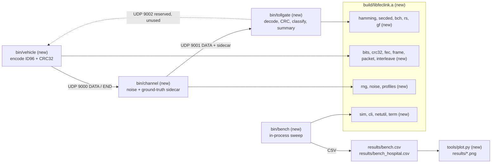

# Architecture history

How the architecture of *Adaptive Multi-Error FEC Link Layer for High-Interference Environments*
changed from the first commit to the final `main`, why each change was made, and what failed.

**Sources.** Everything below comes from `git log` / `git show` / `git ls-tree` on `main` and the
remote branches, from `DECISIONS.md`, `PROGRESS.md`, `PLAN.md`, `README.md`, `docs/REPORT.md`,
`docs/DEMO.md`, and from the `results/*.csv` files regenerated with `make bench` on `main`
(`53c6109`) while writing this document (the CSVs are git-ignored, so they had to be regenerated).
A few checks were re-run by hand for this document; they are marked **(re-run for this document)**.
A number that could not be sourced is written "not measured".

**Version boundaries (confirmed from git).** The history is one linear chain of 37 commits on
`main`; every feature branch was fast-forwarded into it. Branch heads: `claude/bold-gauss-xza289`
= `aa2aaac`, `week2` = `fc5dc28` (= tag `v0.2-week2`), `final-polish` = `c4d7bf4`, `overnight-a`
= `bde2409`, `gate-a` = `754e3e9`, `overnight-b` = `ecd770f`, `gate-b` = `9933409`, `overnight-c`
= `539acca`, `docs-fix` = `b9f8436`, `docs-timings` = `53c6109` = `main`.

| version | git range (oldest..newest) | commits | dates | branches |
|---|---|---|---|---|
| v0.1 | `18c8a87`..`aa2aaac` | 9 | 2026-10-08 | `claude/bold-gauss-xza289` |
| v0.2 | `04a7423`..`fc5dc28` | 6 | 2026-10-08 | `week2`, tag `v0.2-week2` |
| v0.3 | `a6c204e`..`754e3e9` | 12 | 2026-10-08 .. 2026-10-16 | `final-polish`, `overnight-a`, `gate-a` |
| v0.4 | `a5bc434`..`53c6109` | 10 | 2026-10-16 | `overnight-b`, `gate-b`, `overnight-c`, `docs-fix`, `docs-timings` |

Adjustment to the brief: `gate-a` (`754e3e9`) is counted in **v0.3**, because it only corrects
numbers of the overnight-A results; `gate-b` (`9933409`) is counted in v0.4 because it checks
`docs/REPORT.md`, which is a v0.4 file.

Contents: [v0.1](#v01---week-1-phases-0-6) · [v0.2](#v02---week-2-feedback-arq-harq-adaptive-dashboard) ·
[v0.3](#v03---final-polish--overnight-a-fair-baselines-statistics-failure-injection) ·
[v0.4](#v04---overnight-bc-and-docs-ci-report-ldpc-demo-fixes) ·
[A. At a glance](#a-architecture-evolution-at-a-glance) · [B. Results timeline](#b-results-timeline) ·
[C. Lessons](#c-lessons-learned) · [D. Doc issues](#d-doc-issues) · [E. Reproduce](#e-how-to-reproduce-each-version)

---

## v0.1 - Week 1, phases 0-6

### 1. Summary

One-way FEC link: `bin/vehicle` encodes the 96-bit tag ID + CRC-32 with one of six codes (plus an
uncoded baseline), `bin/channel` flips bits (BSC, Gilbert-Elliott or burst model, two profiles)
and appends a ground-truth sidecar, `bin/tollgate` decodes and classifies. All coding logic lives
in one library (`build/libfeclink.a`) shared with an in-process benchmark (`bin/bench`).
Git range `18c8a87`..`aa2aaac` (phase0 `18c8a87`, phase1 `7ab039a`, phase2 `612e846`,
phase3 `c9bc2c7`, phase4 `bbbd2ed`, phase5 `175f75e`, phase6 `d8f026a`, docs `c9cd2a3`, `aa2aaac`).

### 2. Architecture diagram

Everything is new in v0.1. Port 9002 exists only as a reserved flag (`--feedback-port`); nothing
is sent on it yet.



ASCII fallback:

```
 bin/vehicle (new) --UDP 9000--> bin/channel (new) --UDP 9001--> bin/tollgate (new)
  encode ID96+CRC32               noise (bsc/ge/burst)            decode, CRC-32 check,
  FEC code + interleaver          + ground-truth sidecar          classify, summary
        ^                                                                |
        +------------------ UDP 9002 (reserved, unused) ----------------+

 build/libfeclink.a (new): bits crc32 hamming secded gf bch rs interleave fec frame packet
                           rng noise profiles sim cli netutil term version
 bin/bench (new) --> sim (same library, no sockets) --> results/bench.csv, bench_hospital.csv
                                                    --> tools/plot.py --> results/*.png (10 PNGs)
```

### 3. What changed

| component | change | files / modules | commit |
|---|---|---|---|
| scaffolding | Makefile, docs, home-made test helper | `Makefile`, `tests/testlib.h`, `CLAUDE.md`, `PLAN.md`, `DECISIONS.md` | `18c8a87` |
| coding core | bits one-per-byte, CRC-32 (bitwise IEEE 802.3), Hamming(7,4)/(15,11), SECDED(8,4) | `src/bits.c`, `crc32.c`, `hamming.c`, `secded.c` | `7ab039a` |
| channel model | xoshiro256** RNG, BSC / Gilbert-Elliott / burst, TOLL_PLAZA and HOSPITAL_IMAGING | `src/rng.c`, `noise.c`, `profiles.c` | `612e846` |
| processes | three UDP programs, wire format v1 (14-byte header), sidecar, CLI, demo/compare scripts | `src/apps/*.c`, `src/packet.c`, `frame.c`, `fec.c`, `cli.c`, `netutil.c`, `tools/demo.sh`, `compare.sh`, `docs/DEMO.md` | `c9bc2c7` |
| codes | GF(2^m), BCH(15,7) t=2, BCH(31,16) t=3 (Berlekamp-Massey + Chien) | `src/gf.c`, `bch.c` | `bbbd2ed` |
| evaluation | in-process benchmark, CSV, matplotlib plots | `src/sim.c`, `tools/bench.c`, `tools/plot.py` | `175f75e` |
| codes | shortened RS(16+2t,16) over GF(256), generic bit block interleaver | `src/rs.c`, `interleave.c` | `d8f026a` |
| docs | results table in README, final PROGRESS | `README.md`, `PROGRESS.md` | `c9cd2a3`, `aa2aaac` |

### 4. Why

| change | problem it solved / question it answered | evidence |
|---|---|---|
| library + three thin programs | benchmark and UDP pipeline must run exactly the same code | DECISIONS.md "Phase 0" |
| CRC-32 on top of every code | a miscorrection must never bill the wrong car | SILENT_WRONG 0 of 1,395,000 frames in `bench.csv` and 0 of 1,395,000 in `bench_hospital.csv` |
| ground-truth sidecar (decision #6) | live CORRECT / DETECTED_FAIL / SILENT_WRONG classification in the demo | DECISIONS.md "Phase 3" |
| Gilbert-Elliott state kept across frames (#2) | real interference does not know frame boundaries | DECISIONS.md "Phase 2" |
| BCH(31,16) | stronger random-error correction than Hamming | toll BSC p=0.01: 0.9986 vs Hamming(7,4) 0.9354 (`bench.csv`) |
| Reed-Solomon (byte symbols) | bit-level codes collapse on hospital bursts | hospital GE p_gb=0.005: RS t=4 0.8336 vs BCH(31,16) 0.4936, Hamming(7,4) 0.4170 (`bench_hospital.csv`) |
| bit interleaver (#11) | rescue Hamming/BCH against bursts | burst L=16: BCH(31,16) 0.0126 -> BCH(31,16)+il8 1.0000 (`bench.csv`) |
| in-process benchmark | 155,000 frames per code and profile are too slow over UDP | 279 rows x 5000 frames in `bench.csv` |

### 5. Wire format / interface changes

| item | v0.1 |
|---|---|
| DATA/END header | 14 bytes, `PACKET_VERSION 1`: magic "FL", ver, type, code, rs_t, interleave, flags, seq (4), nbits (2) |
| payload | `FEC(ID96 || CRC32)`, bits packed MSB-first, the only corrupted part |
| sidecar | flips (2), profile, model, true tag (12), clean coded bits |
| CLI flags | `--code --profile --model --p --seed --count --delay-ms --burst-len --rs-t --interleave --channel-port --tollgate-port --feedback-port --host --idle-timeout-ms --log --summary-file --show-bits --quiet --color/--no-color --frames --out --help` |
| codes (`--code`) | `none hamming74 hamming1511 secded84 bch157 bch3116 rs` (7 incl. uncoded) |
| make targets | `all test unit-test integration-test demo demo-hospital compare bench plots clean` |

### 6. Test and verification

| test | what it checks | result |
|---|---|---|
| 15 unit-test binaries, 91 test cases (`tests/test_*.c` at `aa2aaac`) | exhaustive single-error Hamming, SECDED double-error detection, BCH weight <= t exhaustive + 200k randomized, RS burst correction, noise statistics | pass |
| `tests/test_integration.sh` | real three-process UDP runs, reproducibility, hospital, BCH, RS, interleaver, compare, bench + plot smoke tests | pass |
| fresh checkout of `aa2aaac`: `make` + `make test` | **(re-run for this document)** | `make` exit 0, `make test` exit 0, "Integration test passed." (plot smoke test skipped: no matplotlib) |

### 7. What failed / what we got wrong

1. **Bit-level codes barely beat "uncoded" on the hospital channel.**
   Expected: any FEC code clearly helps. Actual (hospital GE p_gb=0.005, `bench_hospital.csv`):
   uncoded 0.3952, Hamming(7,4) 0.4170, BCH(15,7) 0.3912, SECDED(8,4) 0.3654 - two codes are
   *worse* than no code. Root cause: Hamming/BCH correct 1-3 bits per block; a 12.5-bit mean burst
   puts many errors in one block. Handled: RS and the interleaver were added in phase 6 (`d8f026a`),
   RS t=4 reaches 0.8336.
2. **The bigger Hamming and SECDED were worse than Hamming(7,4).** Toll BSC p=0.01 (`bench.csv`):
   Hamming(15,11) 0.8956 and SECDED(8,4) 0.9174 vs Hamming(7,4) 0.9354. Root cause: a longer block
   collects more errors per block; SECDED only *detects* the second error, so frame success does
   not improve. Reported as a result, nothing changed.
3. **Bursts longer than the code's design still break everything.** Burst L=16 in every frame:
   Hamming(7,4) 0.0014, BCH(31,16) 0.0126 (`bench.csv`). Expected (it is the point of the burst
   sweep); handled by RS / interleaving. The interleaver's "one burst error per block" guarantee
   only holds when the depth divides the coded length (DECISIONS.md "Phase 6") - left as documented.

### 8. Decisions still open / limitations

- The header is never corrupted (decision #1) - tested only later (v0.3).
- Noise parameters of both profiles are modelling assumptions (decision #5), not measurements.
- No feedback path: a DETECTED_FAIL frame is simply lost (no retransmission).
- RS uses one shortened codeword per frame (decision #10); a symbol interleaver for RS was not built.
- Decode latency is measured on the simulation host only.

---
