# Adaptive Multi-Error FEC Link Layer for High-Interference Environments

*Draft report. Every number below is copied from `results/*.csv` (regenerated with `make bench`),
[`STATUS.md`](STATUS.md) or [`DESIGN_DECISIONS.md`](DESIGN_DECISIONS.md). A number that was not measured is written "not measured".
Noise parameters, the round-trip time and the bit rate are modelling assumptions, not measurements.*

## 1. Abstract

A vehicle's 96-bit RFID tag ID must reach a roadside unit over a noisy wireless link. A
retransmission costs a round trip the moving vehicle may not have, so we correct errors in place
with forward error correction (FEC). We implemented from scratch in C11 (no external libraries)
the CRC-32, a seeded RNG, GF(2^m) arithmetic, Hamming, SECDED, BCH and Reed-Solomon codes and a
block interleaver, and built a three-process UDP simulator (vehicle, noisy channel, tollgate) with
three noise models and two profiles (toll plaza, hospital imaging). We compare plain FEC, Stop-and-Wait ARQ,
Hybrid ARQ (HARQ) and an adaptive controller that changes the code according to receiver
feedback. Findings: on the toll profile (BSC) BCH(31,16) is the best single-shot code of those compared in E1; on the bursty
hospital profile only Reed-Solomon or interleaving help; CRC-32 produced no wrong ID in 1,395,000
frames per profile (SILENT_WRONG = 0). The adaptive controller does **not** clearly beat the best
fixed strategy: fixed HARQ + RS t=4 has higher goodput (0.613 vs 0.504 over 20 seeds).
An all-RS adaptive ladder (a new, pre-registered experiment) raises adaptive goodput to 0.584, still below fixed HARQ + RS t=4.

## 2. Problem and scenarios

At an automated toll booth the tag ID is read while the vehicle passes; a failed read means a
missed charge or a stop. Two scenarios, with parameters defined in `include/profiles.h`:

* **TOLL_PLAZA (primary)** - mostly random bit flips plus short bursts from passing trucks or other
  readers. BSC p = 0.01; Gilbert-Elliott p_gb = 0.002, p_bg = 0.5, e_good = 0.005, e_bad = 0.5;
  burst L = 4 bits in 20% of frames.
* **HOSPITAL_IMAGING (secondary)** - strong impulsive interference near MRI/CT/electrosurgical
  equipment. BSC p = 0.02; Gilbert-Elliott p_gb = 0.005, p_bg = 0.08 (mean burst 12.5 bits),
  e_good = 0.002, e_bad = 0.5; burst L = 16 bits in 50% of frames.

These numbers are **assumptions chosen to make the profiles different**, not field measurements.

## 3. System architecture

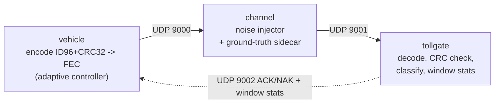

Frame: `header (magic, ver, type, code, rs_t, il, seq, nbits, attempt, strat)` then
`FEC(ID96 || CRC32)` = 128 payload bits before coding. The header is **not** corrupted by the
channel (design record DD-01; see section 7.5 for what happens when it is). The channel appends an
evaluation-only ground-truth sidecar; the decoder never reads it (checked by
`tests/test_receiver.c`, DD-06). Each frame is classified:

* `CORRECT` - CRC passes and ID equals the truth;
* `DETECTED_FAIL` - CRC fails or the decoder flags an uncorrectable block (the system knows not to bill);
* `SILENT_WRONG` - CRC passes but the ID is wrong (the dangerous case; known only via ground truth).

Strategies (`--strategy`): `fec` (one shot), `arq` (Stop-and-Wait, uncoded + CRC), `harq` (FEC first,
retransmit on NAK, type I, no soft combining), `adaptive` (ladder controller on the vehicle, window
statistics reported by the tollgate; W = 32 frames, step up above failure rate 0.20, step down only if
the binomial model predicts the cheaper code fails below 0.05, probe back-off).

## 4. Codes and the mathematics (short)

* **CRC-32 (IEEE 802.3)** over the 12 ID bytes: the 32-bit remainder of m(x)·x^32 divided by G(x).
  Any error pattern that is not a multiple of G(x) changes the remainder, so every burst of up to 32 bits
  is detected (G has degree 32 and a nonzero x^0 term, so it cannot divide a shorter burst), and for
  128-bit messages every 1-, 2- and 3-bit error is detected (`include/crc32.h`); a random
  wrong word passes with probability about 2^-32. It *detects*, it never corrects.
* **Hamming(7,4) / (15,11)**: parity-check matrix H has the binary numbers 1..n as columns. For a
  received word r the syndrome s = H·r equals the column of the flipped position, so s read as a
  number *is* the error position (s = 0: no error). Distance 3: corrects 1 error. **SECDED(8,4)**
  adds an overall parity bit: syndrome non-zero and parity wrong -> single error, corrected;
  syndrome non-zero and parity right -> double error, detected.
* **BCH(15,7) t=2, BCH(31,16) t=3**: g(x) = lcm of the minimal polynomials of α¹..α^2t, so every
  codeword has c(α^j) = 0 for j = 1..2t and d >= 2t+1 (BCH bound). Decoder: syndromes
  S_j = r(α^j); **Berlekamp-Massey** finds the error-locator Λ(x) = Π(1 + X_l x) from S_1..S_2t;
  **Chien search** tests every position i for Λ(α^-i) = 0. GF(16) uses x^4+x+1.
* **Reed-Solomon over GF(256)** (p(x) = x^8+x^4+x^3+x^2+1), shortened to RS(16+2t, 16), one codeword per frame,
  g(x) = (x+α)...(x+α^2t), corrects t *byte* errors. Same syndromes + Berlekamp-Massey + Chien;
  error values by **Forney**: e_i = Ω(X^-1)/Λ'(X^-1). A burst of up to 8t bits touches few bytes, which is why RS
  survives bursts that destroy bit-level codes.
* **Block interleaver** (generic, bit level, depth d): write row-wise, send column-wise, so a burst of
  L bits becomes about L/d errors per codeword. It helps bit-oriented codes against bursts
  (e.g. BCH(31,16) + d=8) but *hurts* RS (DD-15: RS t=4 on hospital drops from 83.4% to
  59.8% with d=8), because it spreads one burst over more bytes.

**LDPC(256,128) (optional stretch, section 7.6).** A codeword is any x with H x = 0 for a sparse
128 x 256 parity-check matrix H with 3 ones per column and 6 per row. The code is linear (the null
space of H), so the syndrome H r = H e depends only on the error pattern. Encoding: Gaussian
elimination turns H into [I | A] (columns permuted), so parity = A * data. Decoding: Gallager bit
flipping - repeatedly flip the bits that sit in the most unsatisfied checks until H r = 0 (success)
or 50 iterations have passed (detected failure).

## 5. Noise models

All randomness goes through the seeded RNG in `include/rng.h`, so runs are reproducible.

* **BSC** - independent flips with probability p.
* **Gilbert-Elliott** - two-state Markov chain (good/bad) with flip probabilities e_good/e_bad;
  state persists across frames and starts in the stationary distribution (DD-02).
* **Burst** - one burst of length L per frame with probability p_frame; first/last bit flipped, inner
  bits with probability 0.5 (DD-03).

`--p` means p, p_gb or p_frame depending on the model (DD-04). The Python/C values of the
profiles are listed in section 2. **They are modelling assumptions.**

## 6. Experiments

| # | Experiment | Command | Output |
|---|---|---|---|
| E1 | Code comparison, both profiles, all codes and noise models, 5000 frames per point, seed 42 | `make bench` | `results/bench.csv`, `bench_hospital.csv` |
| E2 | Strategy comparison (FEC, ARQ, HARQ with fixed codes, adaptive) on channel toll->hospital->toll | `make bench` | `bench_strategy.csv` |
| E3 | RTT sensitivity, 5/20/50 ms | `make bench` | `bench_rtt_{5,20,50}.csv` |
| E4 | Multi-seed (20 seeds 42..61), mean +- 95% CI (Student t), paired differences | `make bench` | `bench_strategy_seeds*.csv` |
| E5 | All-RS ladder (new, pre-registered) | `make bench` | `bench_ladder_rs_seeds*.csv` |
| E6 | Failure injection and header corruption | `make test`, `sh tools/header_experiment.sh 2000` | `tests/test_failure.sh`, `header_corruption.csv` |
| E7 | LDPC(256,128) bit flipping vs BCH(15,7)/BCH(31,16)/RS t=4/RS t=8, both profiles (optional stretch) | `make bench` | `bench_ldpc.csv`, `bench_ldpc_hospital.csv` |

Setup for E2-E5: schedule `toll:2000,hospital:2000,toll:2000` (counted in transmissions), 5000 frames,
RTT 20 ms, timeout 100 ms, max 4 retries, simulated bit rate 160 kbit/s (assumed, DD-13 / DD-14).
**Goodput** = correct frames x 128 payload bits / all coded bits on the air (parity and retransmissions
included; the header is not counted).

## 7. Results

### 7.1 Code comparison (E1, single seed 42)

Frame success rate; BSC p = 0.01, Gilbert-Elliott p_gb = 0.005, burst of L = 16 bits in every frame.

| code | rate | toll BSC | toll GE | hospital GE | burst L=16 |
|---|---|---|---|---|---|
| uncoded | 1.0000 | 0.2700 | 0.3328 | 0.3952 | 0.0000 |
| Hamming(7,4) | 0.5714 | 0.9354 | 0.7752 | 0.4170 | 0.0014 |
| Hamming(7,4) + il8 | 0.5714 | 0.9360 | 0.9394 | 0.6106 | 0.0956 |
| Hamming(15,11) | 0.7111 | 0.8956 | 0.7822 | 0.4720 | 0.0004 |
| SECDED(8,4) | 0.5000 | 0.9174 | 0.7406 | 0.3654 | 0.0008 |
| BCH(15,7) | 0.4491 | 0.9932 | 0.8978 | 0.3912 | 0.0044 |
| BCH(31,16) | 0.5161 | 0.9986 | 0.9596 | 0.4936 | 0.0126 |
| BCH(31,16) + il8 | 0.5161 | 0.9980 | 0.9978 | 0.8374 | 1.0000 |
| RS t=4 | 0.6667 | 0.9634 | 0.9756 | 0.8336 | 1.0000 |

(Columns "toll GE" come from `bench.csv`, "hospital GE" from `bench_hospital.csv`; the BSC and burst columns are the same in both files because the
sweep parameter is explicit.) Reading: BCH(31,16) is best against random errors; for bursts RS or an interleaver is needed;
RS has the highest rate among the strong codes. Decode time per frame (mean_decode_us): uncoded 2.080, Hamming(7,4) 2.872, BCH(15,7) 5.813, BCH(31,16) 9.135, RS t=4 3.479 (microseconds, BSC p = 0.01; timing varies per run).
**SILENT_WRONG: 0 of 1,395,000 frames in `bench.csv` and 0 of 1,395,000 in `bench_hospital.csv`.**

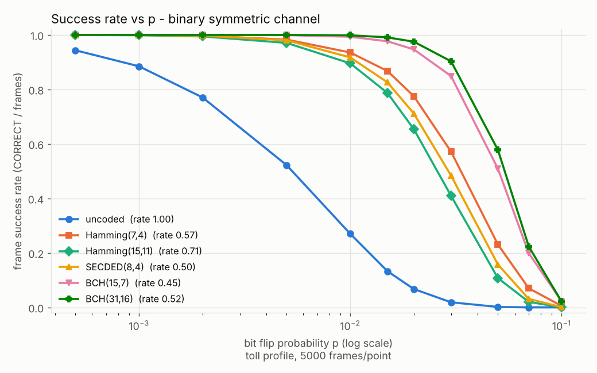
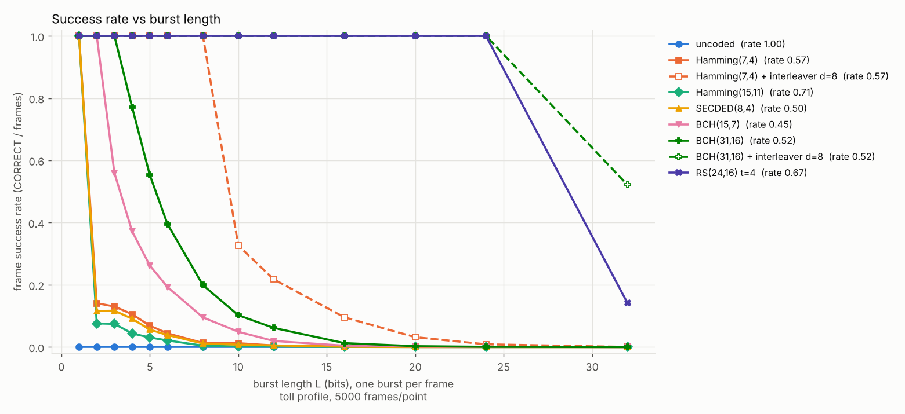
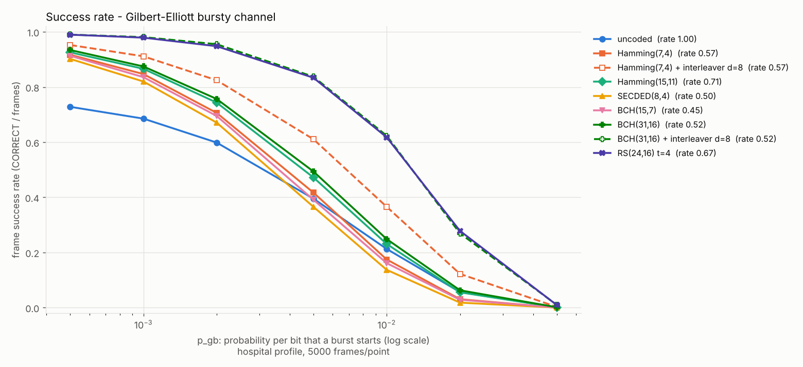

### 7.2 Strategy comparison (E4, 20 seeds, schedule channel, mean +- 95% CI)

| strategy | success | goodput | retx / frame | p99 latency (ms) |
|---|---|---|---|---|
| FEC RS t=8 | 0.9817 +- 0.0010 | 0.4909 +- 0.0005 | 0 | 11.6 |
| Stop-and-Wait ARQ (uncoded) | 0.8244 +- 0.0028 | 0.2960 +- 0.0019 | 1.785 +- 0.009 | 94.0 |
| HARQ BCH(31,16) | 0.9932 +- 0.0006 | 0.4285 +- 0.0009 | 0.196 +- 0.002 | 76.2 |
| HARQ RS t=8 | 1.0000 | 0.4910 +- 0.0005 | 0.018 +- 0.001 | 33.2 |
| **HARQ RS t=4** | 0.99998 +- 0.00003 | **0.6126 +- 0.0012** | 0.088 +- 0.002 | 42.0 +- 5.1 (bimodal: see below) |
| Adaptive (mixed ladder) | 0.9995 +- 0.0001 | 0.5043 +- 0.0025 | 0.069 +- 0.002 | 33.2 |

Paired differences on the same seeds (`bench_strategy_seeds_diff.csv`), adaptive minus baseline:

| metric | vs HARQ RS t=8 | vs HARQ RS t=4 |
|---|---|---|
| success | -0.00051 +- 0.00009 | -0.00049 +- 0.00009 |
| goodput | +0.0133 +- 0.0024 | -0.1083 +- 0.0030 |
| retx / frame | +0.0506 +- 0.0023 | -0.0194 +- 0.0025 |
| p99 latency (ms) | +0.0022 +- 0.0009 | -8.74 +- 5.06 |

The p99 latency of HARQ + RS t=4 is bimodal across seeds (32.4 ms in 11 seeds, 53.6 ms in 9; [DESIGN_DECISIONS.md](DESIGN_DECISIONS.md), DD-23), so its interval is approximate.
Per channel (20 seeds) the adaptive controller reaches success 1.0000 / goodput 0.5333 on toll alone and 0.9995 / 0.4736 on hospital alone; HARQ RS t=4 reaches 0.6441 on toll and 0.5588 on hospital.

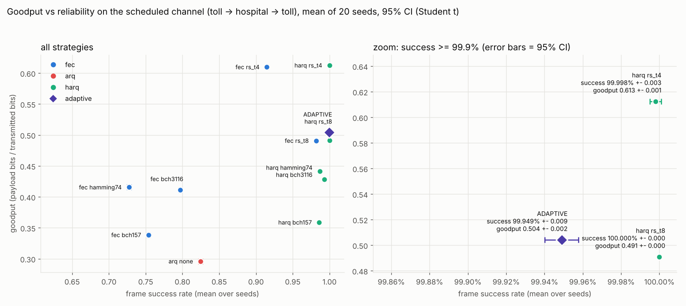
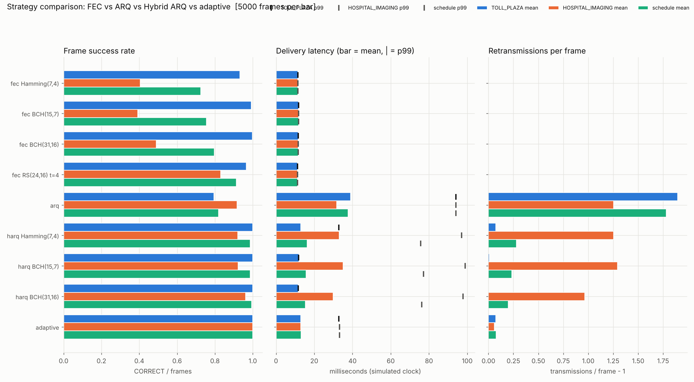
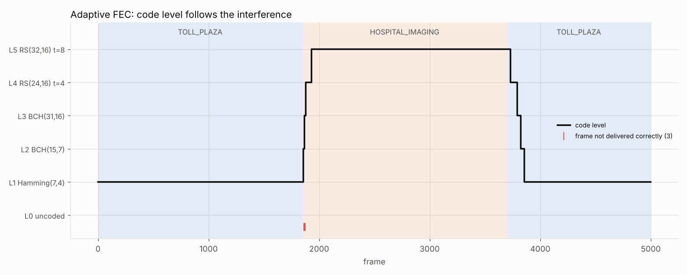

### 7.3 RTT sensitivity (E3, seed 42, schedule channel)

p99 latency in ms (the pipeline simulates RTT split rtt/2 + rtt/2):

| strategy | RTT 5 ms | RTT 20 ms | RTT 50 ms |
|---|---|---|---|
| Stop-and-Wait ARQ | 26.509 | 94.009 | 229.009 |
| HARQ RS t=4 | 9.911 | 32.426 | 77.407 |
| HARQ RS t=8 | 10.711 | 33.211 | 78.211 |
| Adaptive (mixed) | 10.712 | 33.212 | 78.212 |

Rankings do not change with RTT; goodput does not depend on RTT (DESIGN_DECISIONS.md). The RTT values are assumptions.

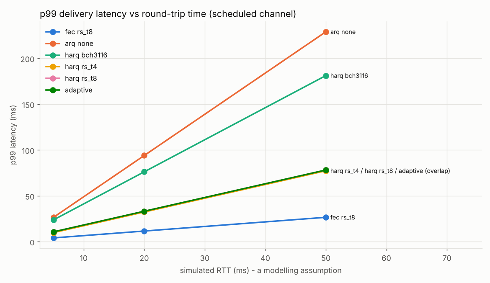

### 7.4 All-RS ladder experiment (E5, new, pre-registered)

Hypothesis written and committed before any run ([DESIGN_DECISIONS.md](DESIGN_DECISIONS.md), DD-24): an adaptive ladder of RS t=1,2,4,6,8
(rates 0.889 .. 0.500) reaches HARQ + RS t=8 reliability at clearly higher goodput than the mixed ladder.
Nothing was tuned afterwards. 20 seeds, schedule channel:

| strategy | success | goodput | retx / frame | p99 (ms) |
|---|---|---|---|---|
| adaptive, all-RS ladder | 0.99999 +- 0.00002 | **0.5841 +- 0.0040** | 0.0554 +- 0.0025 | 33.0 +- 0.1 |
| adaptive, mixed ladder | 0.99949 +- 0.00009 | 0.5043 +- 0.0025 | 0.0689 +- 0.0021 | 33.2 |
| HARQ RS t=8 | 1.00000 | 0.4910 +- 0.0005 | 0.0183 +- 0.0010 | 33.2 |
| HARQ RS t=4 | 0.99998 +- 0.00003 | 0.6126 +- 0.0012 | 0.0883 +- 0.0022 | 42.0 +- 5.1 |

Paired goodput difference of all-RS adaptive: +0.0799 +- 0.0050 vs mixed adaptive, +0.0931 +- 0.0038 vs HARQ RS t=8,
**-0.0284 +- 0.0038 vs HARQ RS t=4**. The pre-registered criteria were met, but the all-RS controller still has lower goodput
than always using HARQ + RS t=4 (on toll alone they tie: 0.6434 vs 0.6441, paired difference -0.0007 +- 0.0009, CI includes 0). Its advantages over fixed RS t=4 are fewer retransmissions
and a lower p99 latency, not goodput.

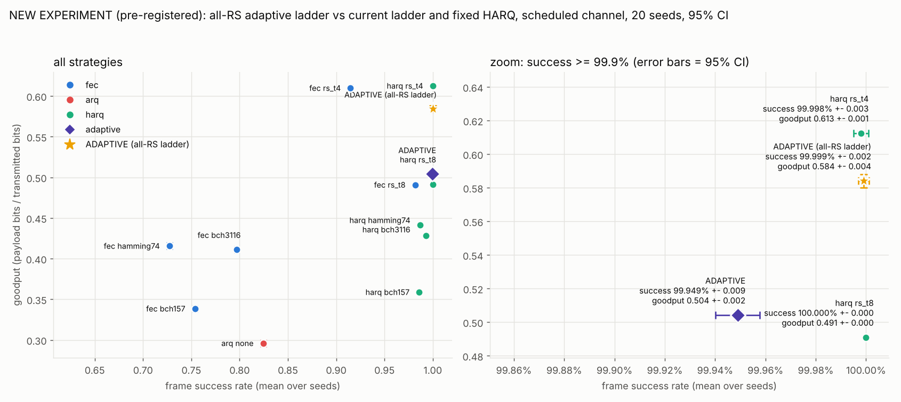

### 7.5 Failure injection (E6)

Covered by `tests/test_packet.c`, `tests/test_fuzz.c` (450k fuzzed inputs), `tests/test_failure.sh`
and `make sanitize` (ASan + UBSan, no findings after the fixes). Real bugs found and fixed
([DESIGN_DECISIONS.md](DESIGN_DECISIONS.md), v0.3 failure injection and sanitizers): an empty datagram stopped the tollgate/channel; an invalid packet
could steal a sequence number; `SO_REUSEADDR` let two processes bind one UDP port; the RS decoder returned uninitialized
data on failure. Bursts longer than any code (L = 4096) give 100% DETECTED_FAIL and no SILENT_WRONG; 100% feedback loss
makes the vehicle give up after max retries.

**Open problem: header corruption.** With `channel --corrupt-header P` (toll, RS t=4, seed 42, 2000 frames,
`results/header_corruption.csv`, regenerated for this report):

| strategy | P | delivered | failed | misrouted | lost | tollgate reports CORRECT |
|---|---|---|---|---|---|---|
| fec | 0 | 1929 | 71 | 0 | 0 | 1929 |
| fec | 0.01 | 1906 | 71 | 3 | 20 | 1909 |
| fec | 0.05 | 1835 | 69 | 13 | 83 | 1845 |
| fec | 0.2 | 1558 | 62 | 51 | 329 | 1599 |
| harq | 0 | 2000 | 0 | 0 | 0 | 2000 |
| harq | 0.01 | 1997 | 1 | 2 | 0 | 2000 |
| harq | 0.05 | 1988 | 2 | 9 | 1 | 2000 |
| harq | 0.2 | 1960 | 2 | 28 | 10 | 2003 |

At P = 0.2 with HARQ the tollgate reports 2003 CORRECT of 2000 frames sent: a flipped seq creates a phantom frame the
tollgate cannot recognise. Not fixed (needs a wire-format change; proposed fix: a CRC-16 over the header).

### 7.6 Optional stretch: LDPC(256,128) with Gallager bit flipping (E7, v0.4)

(3,6)-regular H (128 x 256) built from a seeded RNG with a PEG-style rule (no 4-cycles; girth 6),
systematic encoder from Gaussian elimination, hard-decision bit flipping (flip every bit that
violates the most checks, max 50 iterations, failure if the syndrome is not zero). Unit tests:
every codeword has zero syndrome, every 1- and 2-bit error is corrected (exhaustive), a success is
never a non-codeword. Benchmark: `bin/bench --compare-codes bch157,bch3116,rs,rs_t8,ldpc`, seed 42,
5000 frames per point (`results/bench_ldpc.csv`, `results/bench_ldpc_hospital.csv`). RS t=8 is
included because it has the same rate (0.500) as the LDPC code.

| code | rate | BSC 0.01 | BSC 0.02 | BSC 0.03 | toll GE | hospital GE | burst L=16 | burst L=24 | mean decode |
|---|---|---|---|---|---|---|---|---|---|
| BCH(31,16) | 0.5161 | 0.9986 | 0.9750 | 0.9032 | 0.9596 | 0.4936 | 0.0126 | 0.0008 | 6.9 us |
| RS t=4 | 0.6667 | 0.9634 | 0.7218 | 0.3854 | 0.9756 | 0.8336 | 1.0000 | 1.0000 | 3.3 us |
| RS t=8 | 0.5000 | 0.9996 | 0.9608 | 0.7568 | 0.9996 | 0.9532 | 1.0000 | 1.0000 | 5.6 us |
| LDPC(256,128) | 0.5000 | 0.9994 | 0.9874 | 0.9152 | 0.9988 | 0.7902 | 0.9690 | 0.6916 | 10.5 us |

(GE p_gb = 0.005; mean decode = mean of mean_decode_us over all sweep points of `bench_ldpc.csv`,
timing of this host.) LDPC is the best code for random errors between p = 0.015 and 0.03 and
ties RS t=8 below that, but it is **worse than both RS codes on the bursty hospital channel and on
bursts of 16+ bits**, and its decode time is the highest on average because undecodable frames run
all 50 iterations (25-50 us per frame at BSC p >= 0.05). SILENT_WRONG: 0 of 155,000 frames per
profile. It is not on the adaptive ladder. Single seed; not tuned after seeing results.

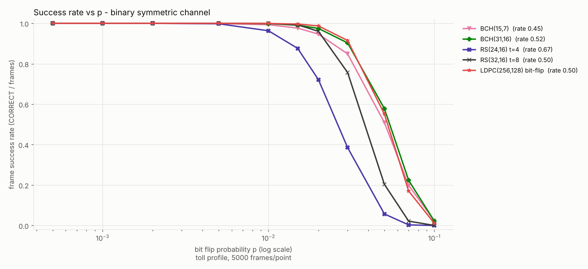
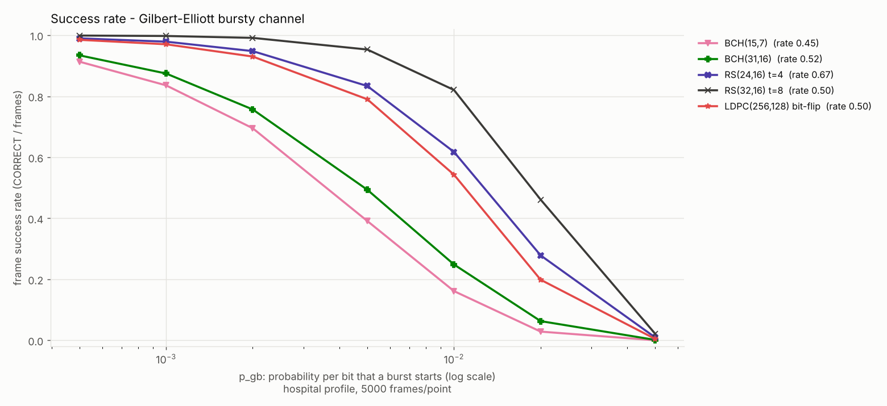
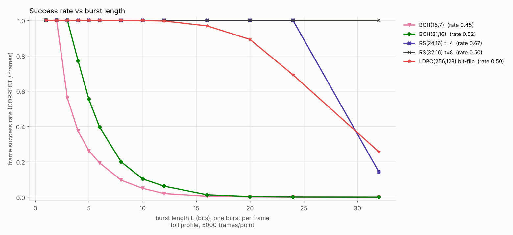

## 8. Limitations (honest)

* **Adaptive does not clearly beat fixed HARQ + RS t=4.** On our channel the best fixed strategy has
  higher goodput (0.6126 vs 0.5043 mixed, 0.5841 all-RS). Adaptive's measurable advantages over it are fewer retransmissions per frame and a lower mean p99 latency (both with caveats above); over always-RS t=8 the goodput advantage is real but small (+0.0133).
* The original expectation "strongest-code reliability at clearly lower overhead" did **not** hold with the mixed ladder (DD-21 notes, v0.3 fair-comparison analysis); the cause is the ladder order (its low rungs have lower code rate than RS t=4).
* Noise parameters, RTT (20 ms), timeout, 160 kbit/s bit rate and the burst model are modelling assumptions; conclusions
  hold for this simulated channel and may not transfer to a real one.
* Software simulation only: **no hardware, no over-the-air measurement.** Decode times are of the simulation host.
* Header is unprotected (open problem above); the HARQ is type I (no soft combining); BER estimate ignores failed frames.
* The duplicate filter keeps seq mod 65536 (fine for < 65536 frames).
* Portability: `make test` and `make sanitize` were run with gcc 13 (and `make test` with clang) on Ubuntu 24.04 only. CI (`.github/workflows/ci.yml`) passed on commit a5bc434 for ubuntu-latest (`make test`, `make sanitize`) and macos-latest (`make test`);
  WSL is **not verified**.
* The p99-latency columns vary slightly per run because the simulator adds the real measured decode time to its clock.
* The 20-seed confidence intervals are Student-t intervals over 20 seeds on one simulated channel, not a statement about real deployments.

## 9. Conclusions

1. Error *correction* with an end-to-end CRC is safe on this channel: no SILENT_WRONG in the 1,395,000 frames per profile of E1.
2. The best code depends on the noise: BCH(31,16) for random errors, Reed-Solomon (byte symbols) or an interleaved bit code for bursts.
3. Feedback strategies matter: Stop-and-Wait ARQ gives success 0.8244 and p99 94.0 ms; HARQ with a strong code gives success of about 1.0 with p99 33.2 ms (RTT 20 ms).
4. Adaptive FEC works as a controller (it follows the toll->hospital->toll schedule) but did not beat the best fixed HARQ + RS t=4 on goodput in our experiments; ladder design matters more than the control logic.

## 10. Future work

* Header CRC-16 (fixes the misrouting) and a header-corruption-resistant seq.
* Soft-combining HARQ (type II), real-measured channel traces, real RTT.
* LDPC: a soft-decision (sum-product) decoder and a longer code (the bit-flipping LDPC(256,128) of section 7.6 loses to RS on bursts).
* Controller that can choose "fixed RS t=4" when that is best (e.g. bandit over fixed codes), and a ladder searched on a held-out channel (not tuned on the evaluation schedule).
* Try the code on a real radio link or hardware-in-the-loop; run macOS/WSL CI.

## 11. How to reproduce

```sh
make                 # build bin/vehicle bin/channel bin/tollgate bin/bench
make test            # 24 unit-test binaries + integration + failure-injection tests
make sanitize        # same under ASan + UBSan
make bench           # E1-E5, E7: writes results/*.csv (about 100 s; CSVs are git-ignored)
pip install -r requirements.txt && make plots   # results/*.png (needs matplotlib)
sh tools/header_experiment.sh 2000              # E6 header corruption -> results/header_corruption.csv
make demo | make demo-hospital | make demo-adaptive | make compare | make dashboard
```

Seeds, ports and flags are fixed (`SEED=42`, 20 seeds 42..61, schedule `toll:2000,hospital:2000,toll:2000`, 5000 frames).
